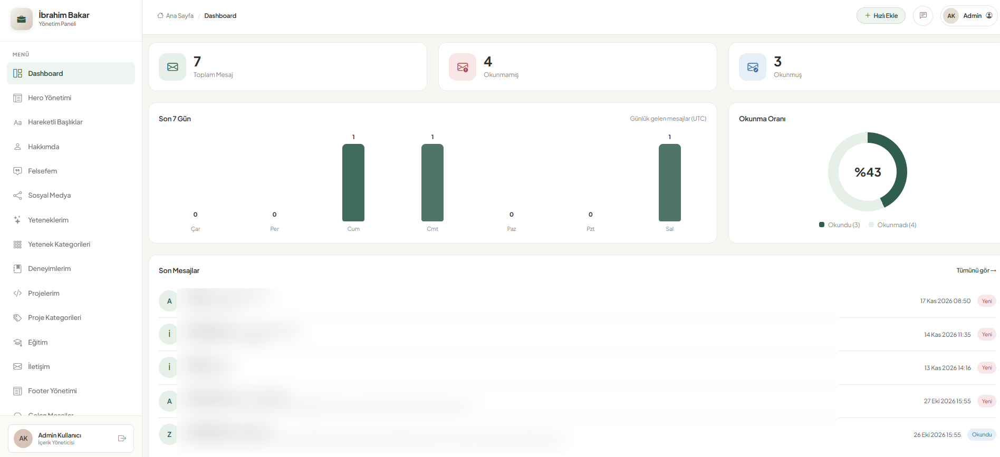
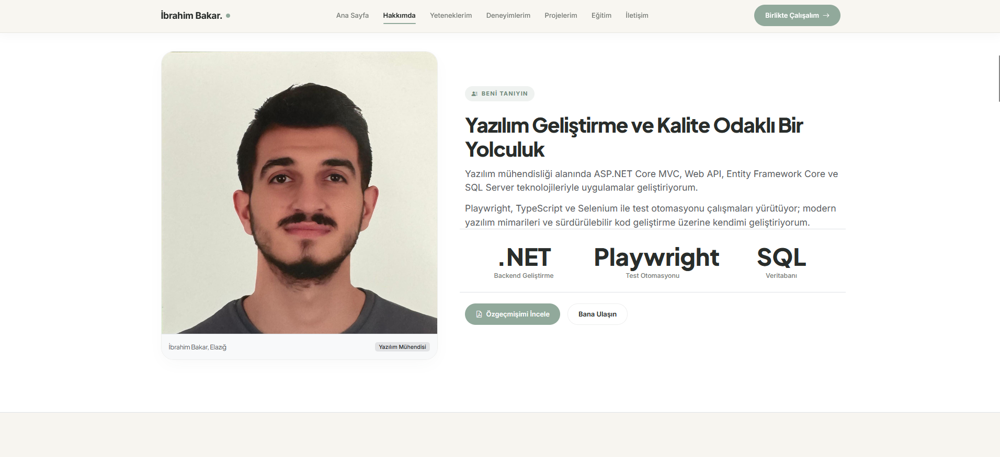
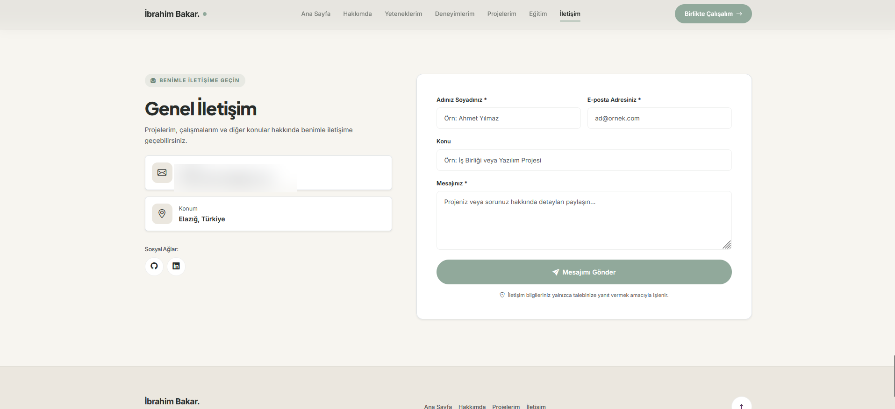

# MyAcademy Portfolio

MyAcademy Portfolio, ASP.NET Core MVC (.NET 9), Entity Framework Core ve SQL Server kullanılarak geliştirilmiş, dinamik içerik yönetimine sahip kişisel portfolyo uygulamasıdır. Proje, ziyaretçilere yönelik modern bir arayüz ile rol tabanlı yetkilendirmeyle korunan kapsamlı bir yönetim panelini bir araya getirir.

## Kullanılan teknolojiler

- **Uygulama:** C#, ASP.NET Core MVC (.NET 9), MVC Areas
- **Veri erişimi:** Entity Framework Core 9 (Code First), LINQ, SQL Server
- **Kimlik ve yetkilendirme:** ASP.NET Core Identity, Cookie Authentication, Role-based Authorization
- **Arayüz:** Razor Views, ViewComponents, Bootstrap 5, CSS ve JavaScript
- **Görsel işleme:** SkiaSharp
- **Test araçları:** xUnit, WebApplicationFactory, SQLite, SQL Server ve Playwright / Microsoft Edge

## Ekran görüntüleri

### Portfolyo ana sayfası


### Admin Dashboard



### Admin giriş


### Proje oluşturma


### Hakkımda



### İletişim



## Projenin özellikleri

- **Dinamik portfolyo yönetimi:** Karşılama alanı, unvanlar, Hakkımda, yetenekler, deneyim, eğitim, sosyal bağlantılar ve kategori filtreli proje kartları.
- **Admin CRUD işlemleri:** İçerik ve kategori oluşturma, listeleme, güncelleme ve silme; ilgili modüllerde arama, filtreleme ve aktif/pasif durum yönetimi.
- **Dashboard istatistikleri:** Mesaj sayıları, okunma durumları ve son yedi güne ait mesaj grafiği.
- **Mesaj ve iletişim yönetimi:** Ziyaretçi iletişim formu, gelen mesajların yönetimi ve iletişim bilgilerinin düzenlenmesi.
- **Görsel ve PDF yükleme:** Proje görselleri için önizleme ve yükleme, PDF formatında CV yükleme ve indirme.
- **Responsive tasarım:** Mobil, tablet ve masaüstü ekranlarına uyumlu ziyaretçi arayüzü ve yönetim paneli.

## Uygulama mimarisi

Uygulama, MVC yapısını ve yönetim ekranları için ayrı bir Admin Area kullanır. Controller'lar HTTP isteklerini karşılar, ViewModel'ler form ve görünüm verilerini taşır. `PortfolioContext`, Entity Framework Core üzerinden SQL Server'a erişir. Ziyaretçi sayfasındaki dinamik bölümler, veritabanından içerik okuyan ViewComponent'ler ile oluşturulur.

```text
MyAcademy_PortfolioProject.sln
├── MyAcademy_Portfolio/
│   ├── Areas/Admin/       # Yönetim controller, model ve görünümleri
│   ├── Context/           # EF Core DbContext
│   ├── Controllers/       # Ziyaretçi arayüzünün controller'ları
│   ├── Entities/          # İçerik ve Identity modelleri
│   ├── Infrastructure/    # Dosya yükleme, güvenlik ve hosting yardımcıları
│   ├── Migrations/        # Veritabanı şema geçmişi
│   ├── Models/            # Ziyaretçi arayüzünün ViewModel'leri
│   ├── Seed/              # Development ortamında Admin kurulumu
│   ├── ViewComponents/    # Dinamik portfolyo bölümleri
│   ├── Views/             # Razor görünümleri
│   └── wwwroot/           # Statik dosyalar ve üçüncü taraf lisansları
├── MyAcademy_PortfolioProject.Tests/
├── tools/SqlAudit/
└── docs/
```

## Kurulum ve çalıştırma

.NET **9 SDK**, SQL Server/Express veya LocalDB ve EF Core 9 CLI gereklidir. Tarayıcı testleri için Microsoft Edge kullanılır.

```powershell
git clone https://github.com/ibrahimbkrr/MyAcademy-Portfolio.git
cd MyAcademy-Portfolio
dotnet restore MyAcademy_PortfolioProject.sln
```

[Yerel kurulum rehberindeki](docs/SETUP.md) adımları izleyin:

1. Kendi SQL Server bağlantı dizenizi User Secrets'a kaydedin.
2. Yeni, boş veritabanına migration'ları Development seeder'ı kapalıyken uygulayın. Ortam ayarları aşağıdaki bölümde açıklanmıştır.
3. İlk yerel Admin hesabı için kendi bilgilerinizi rehberdeki güvenli yöntemle sağlayın. Admin seeder'ı yalnızca Development ortamında çalışır.
4. Geliştirme sertifikasına güven verip uygulamayı HTTPS profiliyle başlatın:

```powershell
dotnet dev-certs https --trust
dotnet run --project MyAcademy_Portfolio --launch-profile https
```

Portfolyo `/`, Admin giriş ekranı `/Admin/Account/Login` yolundadır. Kullanılan adres ve portlar terminal çıktısında gösterilir. Repository mevcut geliştirme veritabanını, hazır Admin hesabını veya kişisel yüklemeleri içermez. İlk kurulumdan sonra içeriklerinizi yönetim panelinden ekleyebilirsiniz.

### Testler

```powershell
dotnet build MyAcademy_PortfolioProject.sln -c Release
dotnet test MyAcademy_PortfolioProject.sln -c Release
```

SQL Server ve restore doğrulama testleri ayrıca yapılandırma gerektirir; standart koşuda bu beş test atlanır. İzole veritabanları ve tarayıcı testlerinin çalıştırılması için [test rehberine](docs/TESTING.md) bakın.

## Veritabanı ve migration yönetimi

Veritabanı şeması EF Core Code First migration'larıyla yönetilir. Uygulama açılışında otomatik migration çalıştırılmaz.

Yeni, boş veritabanını oluşturmak için önce [kurulum rehberindeki](docs/SETUP.md) bağlantı adımını tamamlayarak `ConnectionStrings__DefaultConnection` ortam değişkenini kendi bağlantınızla tanımlayın. `Testing` ortamı User Secrets'ı varsayılan olarak yüklemediğinden bu işlem gereklidir. Ardından seeder'ı devre dışı bırakan ortam ayarlarıyla çalıştırın:

```powershell
$env:ASPNETCORE_ENVIRONMENT = 'Testing'
$env:DOTNET_ENVIRONMENT = 'Testing'
dotnet ef database update --project MyAcademy_Portfolio
# İşlem başarıyla tamamlandıktan sonra geçici ortam değerlerini temizleyin:
Remove-Item Env:ConnectionStrings__DefaultConnection
Remove-Item Env:ASPNETCORE_ENVIRONMENT
Remove-Item Env:DOTNET_ENVIRONMENT
```

Kategori adı ve NULL olmayan filtre anahtarları için benzersiz indeksler bulunur. Mevcut verideki çakışmalar migration tarafından otomatik olarak silinmez veya birleştirilmez. Dolu bir veritabanını yükseltmeden önce yedek alın, değişiklikleri ayrı bir geri yükleme kopyasında doğrulayın ve çakışan kayıtları inceleyin. Eski `Skills` şeması veri dönüşümü gerektirebilir; mevcut migration geçmişini sıfırlamayın.

## Güvenlik özellikleri

- **Yetkilendirme:** Admin Area, Identity ve Admin rolüne dayalı erişim denetimiyle korunur.
- **Oturum güvenliği:** Kimlik doğrulama çerezlerinde HttpOnly, Secure ve SameSite ayarları; başarısız giriş denemelerinde hesap kilitleme uygulanır.
- **Form güvenliği:** POST formlarında antiforgery doğrulaması, iletişim formunda IP bazlı istek sınırı bulunur.
- **Dosya doğrulama:** JPG, PNG ve WEBP görselleri içerik kontrolünden geçirilip SkiaSharp ile yeniden kodlanır; boyut sınırı 5 MB'dir. PDF CV dosyalarında 10 MB sınırı ve temel dosya biçimi kontrolleri uygulanır. PDF doğrulaması antivirüs taraması değildir.
- **Dosya ve yapılandırma yönetimi:** Yüklemeler benzersiz adlarla saklanır; başarısız kayıtlarda yeni dosyalar temizlenir. Bağlantı dizeleri ve Admin kurulum bilgileri kaynak koda eklenmeden User Secrets veya ortam değişkenleriyle sağlanır.

## Proje durumu

Uygulama yerel geliştirme ortamında çalıştırılmış ve doğrulanmıştır. Azure veya başka bir canlı sunucuya dağıtılmamıştır; hedef framework .NET 9'dur. Canlı ortam için TLS/proxy ayarları, kalıcı dosya ve Data Protection anahtar depolaması, yedekleme ve birden fazla uygulama örneğiyle çalışma ayrıca doğrulanmalıdır.

Kullanılan üçüncü taraf kütüphanelerin lisans ve telif bildirimleri kaynak dosyalarla birlikte korunmuştur.

## Geliştirici

**Geliştirici:** İbrahim Bakar

**GitHub:** [ibrahimbkrr](https://github.com/ibrahimbkrr)

**LinkedIn:** [İbrahim Bakar](https://www.linkedin.com/in/ibrahim-bakar-369464238)
