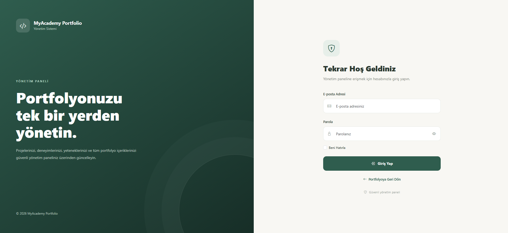
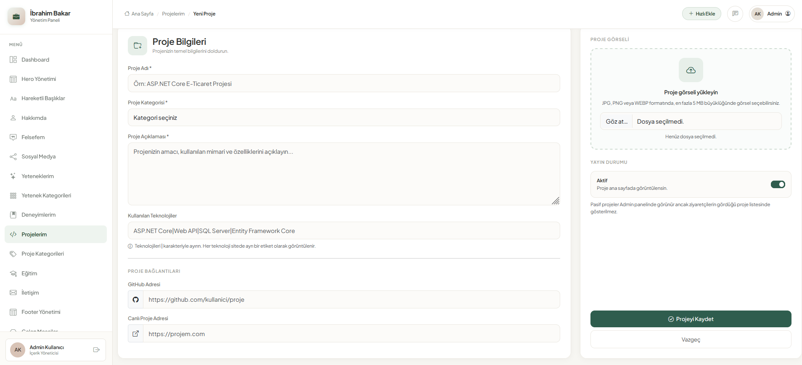
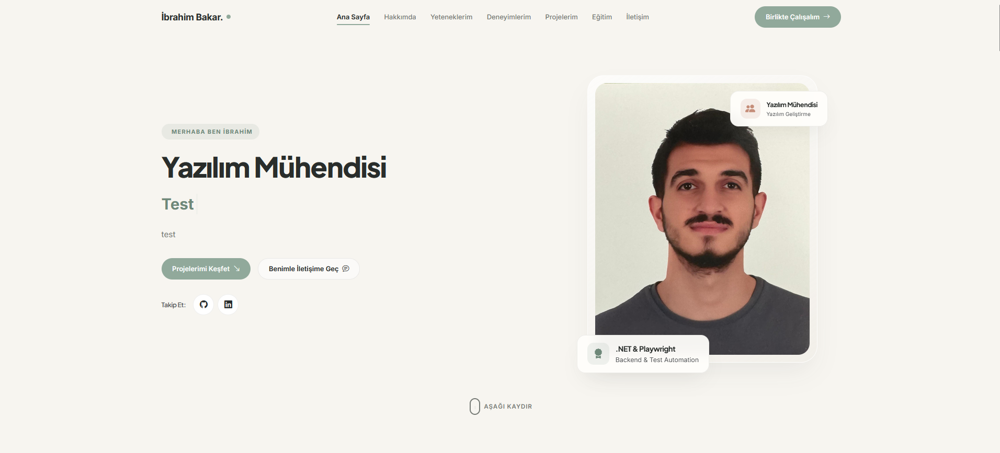

# MyAcademy Portfolio

ASP.NET Core MVC ile geliştirilen, SQL Server üzerindeki portfolyo içeriklerini Admin panelinden yönetmeye olanak sağlayan web uygulaması.

**Geliştirici: İbrahim Bakar.** Proje, Murat Yücedağ'ın eğitmenliğinde M&Y Yazılım Eğitim Akademi Danışmanlık bünyesindeki eğitim sürecinde geliştirilmiştir.

## Teknolojiler

- **Backend:** C#, ASP.NET Core MVC (.NET 9)
- **Veri erişimi:** Entity Framework Core 9, LINQ, Code First migrations, SQL Server
- **Kimlik:** ASP.NET Core Identity, cookie authentication, Admin rolü
- **Arayüz:** Razor Views, ViewComponents, Bootstrap 5, CSS ve JavaScript
- **Dosya işleme:** SkiaSharp ile görsel doğrulama ve yeniden kodlama
- **Test:** xUnit, WebApplicationFactory, SQLite, SQL Server, Playwright / Microsoft Edge

## Özellikler

**Portfolyo:** Dinamik karşılama ve hareketli unvanlar; Hakkımda, yetenek, deneyim ve eğitim bölümleri; kategori filtreli proje kartları; sosyal bağlantılar, CV indirme ve iletişim formu. İçerikler ViewComponent'ler aracılığıyla veritabanından okunur. Tasarım mobil, tablet ve masaüstü ekranlarına uyumludur.

**Admin:** İçerik ve kategoriler için CRUD işlemleri, aktif/pasif durumları, liste arama ve filtreleme, görsel önizleme, mesaj yönetimi ve dashboard istatistikleri. Public sayfanın bölümleri, iletişim bilgileri ve footer yönetim panelinden düzenlenir.

**Güvenlik:** Admin Area rol bazlı yetkilendirme ile korunur. POST formlarında antiforgery; login denemelerinde lockout; cookie üzerinde HttpOnly/Secure/SameSite ayarları; iletişim formunda IP bazlı hız sınırı bulunur. Repo hazır Admin hesabı veya parola içermez.

**Upload:** JPG/PNG/WEBP için içerik doğrulaması, decode/reencode ve 5 MB sınırı; PDF CV için 10 MB sınırı uygulanır. Dosyalar benzersiz adlarla kaydedilir; başarısız kayıtlarda yeni dosya temizlenir. PDF kontrolü antivirüs veya tam içerik sanitization hizmeti değildir. Kişisel CV ve kullanıcı upload'ları repoya dahil edilmez.

## Mimari

Uygulama MVC ve Admin Area düzenindedir. Controller'lar istekleri karşılar; ViewModel'ler form/görünüm verisini taşır; `PortfolioContext` EF Core üzerinden SQL Server'a erişir. Public sayfa bölümleri ViewComponent'lerle oluşturulur.

```text
MyAcademy_PortfolioProject.sln
├── MyAcademy_Portfolio/
│   ├── Areas/Admin/       # Yönetim controller, model ve görünümleri
│   ├── Context/           # EF Core DbContext
│   ├── Controllers/       # Public HTTP endpointleri
│   ├── Entities/          # İçerik ve Identity modelleri
│   ├── Infrastructure/    # Upload, güvenlik ve hosting yardımcıları
│   ├── Migrations/        # Veritabanı schema geçmişi
│   ├── Models/            # Public ViewModel'ler
│   ├── Seed/              # Development Admin kurulumu
│   ├── ViewComponents/    # Dinamik portfolyo bölümleri
│   ├── Views/             # Razor görünümleri
│   └── wwwroot/           # Statik dosyalar ve vendor lisansları
├── MyAcademy_PortfolioProject.Tests/
├── tools/SqlAudit/
└── docs/
```

## Kurulum

.NET **9 SDK**, SQL Server/Express veya LocalDB ve EF Core 9 CLI gerekir. Browser testleri Microsoft Edge kullanır.

```powershell
git clone https://github.com/ibrahimbkrr/MyAcademy-Portfolio.git
cd MyAcademy-Portfolio
dotnet restore MyAcademy_PortfolioProject.sln
```

Ardından [yerel kurulum rehberindeki](docs/SETUP.md) adımlarla:

1. Kendi bağlantı dizenizi User Secrets'a kaydedin.
2. Yeni, boş veritabanına migration'ları seeder kapalıyken uygulayın.
3. Kendi yerel Admin hesabınızın bilgilerini güvenli biçimde sağlayın.
4. Uygulamayı HTTPS profiliyle başlatın:

```powershell
dotnet run --project MyAcademy_Portfolio --launch-profile https
```

Public sayfa `/`, Admin giriş ekranı `/Admin/Account/Login` yolundadır. Portlar terminal çıktısında gösterilir. Repo mevcut geliştirme veritabanını veya kişisel içerikleri içermez; ilk kurulumdan sonra içeriklerinizi yönetim panelinden ekleyebilirsiniz.

## Veritabanı

EF Core migration'ları kaynakta korunur. Proje kategorileri ve yetenek kategorileri ilişkili içeriklerle yönetilir. Kategori adı ve non-NULL filtre anahtarlarına unique index uygulanır; çakışan mevcut veri için migration otomatik silme/birleştirme yapmaz.

Uygulama açılışında otomatik migration çalışmaz. Dolu bir veritabanını yükseltmeden önce yedek ve ayrı restore provası yapın. Eski Skills schema'sı için veri dönüşümü gerekebilir; migration geçmişini sıfırlamayın.

## Testler

```powershell
dotnet build MyAcademy_PortfolioProject.sln -c Release
dotnet test MyAcademy_PortfolioProject.sln -c Release
```

Son tam yerel regresyonda **97 test geçmiştir**. Bu koşu SQL Server ve doğrulanmış restore ortamı için opt-in yapılandırmasını içerir. Standart koşuda bu ortamları gerektiren beş test yapılandırma yoksa SKIP olur.

Kapsam; Identity login/logout, yetkilendirme, CSRF, Admin CRUD, validation, upload, frontend rendering, migration, SQL bütünlüğü ve 390/768/1440 px Edge akışlarını içerir. Yazma yapan testler izole veritabanlarını kullanır. Ayrıntılar: [test rehberi](docs/TESTING.md).

## Ekran görüntüleri

### Admin giriş


### Dashboard ve mesaj istatistikleri


### Proje oluşturma


### Portfolyo ana sayfa


### Hakkımda


### İletişim


## Proje durumu

Uygulama yerel geliştirme ortamında çalıştırılmıştır; Azure veya başka bir canlı ortama dağıtılmamıştır. .NET 9 hedefi korunur. Gerçek hosting ortamında TLS/proxy, kalıcı dosya ve Data Protection depolaması, yedekleme ve çoklu instance davranışı ayrıca doğrulanmalıdır. Test sonuçları tek başına üretim uygunluğu garantisi değildir.

## Teşekkür

Eğitim sürecindeki katkıları için **Murat Yücedağ'a** ve **M&Y Yazılım Eğitim Akademi Danışmanlık'a** teşekkür ederim. Kullanılan üçüncü taraf kütüphanelerin lisans ve telif bildirimleri kaynak dosyalarla birlikte korunmuştur.

